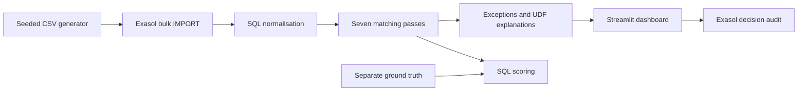

# Milaan: closing the books before noon

Help an NBFC reconciliation analyst move from chasing receipts to reviewing the exceptions that matter. Milaan reconciles a month of 10 million source records inside Exasol Personal in a measured 88.23 seconds.

[](LICENSE)
[](https://github.com/Hemanth-Chilakala/milaan/actions/workflows/ci.yml)
[](https://codespaces.new/Hemanth-Chilakala/milaan)

The Singleton · Hemanth Chilakala · ExaThon India 2026 · Track 1: Money, Risk & Regulation.

## Problem statement

A reconciliation analyst at a mid-sized Indian NBFC can't close the day's books on time because UPI, NACH and payment-gateway settlement files arrive in different formats with mismatched references, so they chase breaks by hand in Excel. If this worked, they'd close the books before noon and spend their time only on the exceptions that actually matter.

References, settlement dates and gross versus net amounts disagree. Batch credits and returned auto-debits make a simple spreadsheet join insufficient. Suspense can delay closing and leave a paid customer looking overdue. The workflow models Sahyog Finance Ltd, a fictional NBFC.

## Demonstration

Demo video: docs/video/demo.mp4 · [Deck PDF](docs/deck/milaan_deck.pdf) · [PowerPoint](docs/deck/milaan_deck.pptx)


The final video is assembled separately from the supplied silent footage and editor assets. The editor will add the final video, script and credits.

## What Milaan does

- Bulk-imports four synthetic collection files directly into Exasol.
- Runs seven explainable matching and classification passes inside the database.
- Handles fee netting, many-to-one settlements and bounded split payments.
- Ranks unresolved items by amount, business-day age and risk.
- Records analyst reviews and measures accuracy against separate ground truth.

## Why Exasol

Bulk IMPORT, SQL normalisation, joins, aggregation, window functions, similarity and subset-sum UDFs, explanations and scoring execute inside Exasol Personal. Python orchestrates SQL and displays aggregates or 50-row pages; it does not retrieve millions of transactions for matching.

<!-- MEASUREMENTS_START -->
**10,000,000 source records in 88.23 seconds**, measured without a browser or recorder on **4 cores / 15.62 GiB RAM**. **98.538%** of source records were grouped, with **100.000% link precision**, **100.000% recall**, **0 false links** and **0 missed expected links**. Timings include preparation, results, conflict validation, commits and SQL scoring; explanations and native profiling flush follow the timer. Fresh recorded timings and overhead are pending the footage checkpoint.

14 Oct 2026: **29.487s core matching**, **9.966s scoring and validation**, **39.459s total**. The core includes preparation, active sets, all matching passes, result append and classification. The 10-second core target was missed. The separately labelled 13 Oct catch-up took 88.387s total. See [benchmarks](docs/benchmarks.md) for run IDs and measured stages. The prepared-state month excludes the explicit 27.011s demo reset before the timer; the full rerun including open-item restoration took 207.039s. Both observations are preserved, and footage overhead will compare equivalent prepared starting states.
<!-- MEASUREMENTS_END -->

## How we validated

The event oracle records the known links separately before source fields are corrupted. Matching never reads those labels. Normal and reused blind seed 20261025 are regression checks. The earlier hard seed 20261104 informed reversal handling, so it is labelled **hard (tuned)**. Seed 20261105 was unused before this measurement and is labelled **hard (blind)**. SQL/UDF hashes were frozen before all four current runs.

| 1M dataset | Seed | Precision | Recall | False links | Missed links | Exceptions |
|---|---:|---:|---:|---:|---:|---:|
| Normal | 42 | 100.000% | 100.000% | 0 | 0 | 10,171 |
| Blind | 20261025 | 100.000% | 100.000% | 0 | 0 | 12,071 |
| Hard (tuned) | 20261104 | 100.000% | 85.872% | 0 | 62,123 | 107,891 |
| Hard (blind) | 20261105 | 100.000% | 85.867% | 0 | 62,132 | 108,103 |

Bank debit/credit pairs with the same normalised reference and amount are excluded before matching. A late reversal reopens its previous daily match for review. Ambiguous reversal relationships are held for review rather than assigned an arbitrary pair. These controlled synthetic results do not establish production accuracy; an independently labelled NBFC partner dataset is needed. See [raw validation](docs/validation_results.json).

## Architecture



See [architecture](docs/architecture.md) and [data model](docs/data_model.md).

## Quick start

Requirements: Python 3.12, Podman, and passwordless sudo for the verified container setup. Use at least 4 cores, 16 GB RAM and 32 GB disk; leave about 8 GB free for generated files and database growth. An 8-core/32-GB machine offers more headroom. Node.js, Playwright and ffmpeg are used for presentation exports.

### Option A: Codespaces

After publication, click the Codespaces badge. The devcontainer installs the launcher and Python dependencies. For an existing Codespace, open this folder as the workspace and run `bash .devcontainer/post-create.sh`; adding a devcontainer to a subfolder does not rebuild the parent workspace.

Review the [Exasol Personal EULA](https://www.exasol.com/terms-and-conditions/#h-exasol-personal-end-user-license-agreement), then run:

```bash
ACCEPT_EXASOL_EULA=yes make bootstrap
make demo
```

Bootstrap installs the launcher and Python script-language container, verifies SQL and Python UDF execution, and creates an owner-only `.env`. It preserves an existing `.env` and deployment. Re-running it is safe; it refuses to start without explicit EULA acceptance.

Open forwarded port 8501. For the larger demonstration:

```bash
make data ROWS=10000000
make load DATA=data/10000000
make recon explain score
make app
```

`ROWS` is the combined source-record count across four files, not the number of ledger receipts. Ground truth and the calendar are additional files. Generation reuses an existing seed-42 dataset with the requested size; it never overwrites source CSVs.

The wrapper uses rootful Podman, crun and native workspace storage because Python runtime mounts failed under this host's nested rootless setup. Use it consistently:

```bash
bash scripts/exasol-local.sh info
bash scripts/exasol-local.sh stop
bash scripts/exasol-local.sh start
```

If the container stops answering after an idle period, stop and start it with the wrapper. Keep port 8563 private. See [environment verification](docs/environment.md).

### Option B: local Linux, macOS or Windows

Ubuntu Linux: install Python 3.12 with its venv module, clone and enter the published repository, then run `ACCEPT_EXASOL_EULA=yes make bootstrap` followed by `make demo`. Podman storage must use a native filesystem. Windows: use Ubuntu under WSL2, make at least 16 GB RAM available, install Python 3.12 and Podman, and follow those Linux commands.

macOS: install Python 3.12 and use the [official Exasol Personal local deployment](https://exasol.github.io/exasol-personal/latest/) with its supported Podman-machine setup. The Codespace-specific sudo wrapper is not a macOS launcher. Connect the app to that deployment:

```bash
python3.12 -m venv .venv
.venv/bin/python -m pip install -r requirements.lock
cp .env.example .env
# Set host, TLS fingerprint and credentials from your deployment in .env.
make demo
```

## Troubleshooting

| Symptom | Fix |
|---|---|
| `Resource temporarily unavailable` or Nano cannot start threads | Use the supplied crun configuration and wrapper; earlier rootless runc deployments applied `pids.max=1`. Inspect the container's process limit and migrate only a stopped legacy deployment with `podman system migrate --new-runtime crun`. |
| Python SLC mounting fails with `Invalid argument` | Put Podman graph storage on a native ext4 filesystem; the wrapper defaults to workspace `private/podman-storage`, rather than the Codespace root overlay. |
| Launcher says running, but SQL fails after idle | Run `bash scripts/exasol-local.sh stop --auto-approve`, then `bash scripts/exasol-local.sh start --auto-approve`, and retry bootstrap. |
| Low disk space | Keep at least 6 GB free. Remove disposable caches, old recordings and regenerable 1M data. Retain the 10M dataset and working deployment. |
| Codespace container changed | Re-run bootstrap to recreate disposable Python dependencies. In an existing parent workspace, the project's devcontainer must be selected before a rebuild. |

Runtime dependencies are pinned in `requirements.lock`. Tests, lint and capture tools are in `requirements-dev.txt`, which includes that runtime lock. Installing development dependencies: `.venv/bin/python -m pip install -r requirements-dev.txt`.

## Configuration

| Variable | Purpose |
|---|---|
| `EXASOL_DSN` | `host/SHA256-fingerprint:8563`; encrypted, certificate pinned |
| `EXASOL_USER` | Deployment login |
| `EXASOL_PASSWORD` | Private deployment secret; `.env` is ignored |

The local environment check writes `.env` with owner-only permissions and preserves existing files. No inference API key is required. Explanations are evidence templates executed inside Exasol. `LLM_PROVIDER` and `LLM_API_KEY` are commented future-extension placeholders; this release makes no external inference calls. The tested PII masking helper is available for future integration.

## Usage

| Target | Purpose |
|---|---|
| `make bootstrap` | EULA-gated, idempotent local installation and connection verification |
| `make setup` | Connect; create schemas and Python UDFs |
| `make data ROWS=1000000` | Generate or reuse seed-42 data; default 1M |
| `make load DATA=data/1000000` | Bulk import and SQL normalisation |
| `make recon` | Seven passes, timings, conflict validation and SQL scoring |
| `make recon-day DATE=2026-10-14` | Close arriving records against prior open items in an independent daily workspace |
| `make explain` | Generate exception explanations inside Exasol |
| `make score` | Print overall and per-break scores |
| `make app` | Start dashboard on port 8501 |
| `make bench` | Measure 1M and 10M runs; update benchmark artifacts |
| `make demo` | Setup, data, load, reconcile, explain and app |
| `make demo-ready` | Verify database, retained data, recent results and dashboard; warm every page |
| `make test` | Run tests without a database |
| `make lint` | Ruff lint and formatting checks |

Before a presentation, start `make app` and run `make demo-ready` in another terminal. It uses the development Playwright browser to warm dashboard pages; install it with `.venv/bin/python -m playwright install --with-deps chromium` if needed. Open the forwarded URL with `?present=1` for presentation mode.

For custom scenario rates, edit `generator/config.yaml` and choose a fresh output folder. Direct generator options are available with `.venv/bin/python -m generator.generate --help`.

Review decisions record acceptance of a recommendation, rejection or assignment. They do not change a real ledger or turn an unverified exception into an automatic match.

## Data

**All data is synthetic, generated by `generator/`. No real customer, bank or employer data is used.**

Sahyog Finance Ltd, Bharat Union Bank, PayFast and the handles are fictional in this demonstration. Faker generates customer-name strings; any resemblance to people is coincidental. Dates, holidays and scenario rates are illustrative. Integer paise comparisons avoid floating-point money errors.

Ground truth records correct links and break labels. Matching never reads it. Precision and recall measure links; auto-match rate measures source membership in groups. A gateway payment can belong to a valid bank batch while still raising a missing-ledger exception.

## Accuracy, benchmarks and tests

[Benchmark report](docs/benchmarks.md) · [Machine-readable observations](docs/benchmark_results.json) · [Reproduction review](docs/reproducibility.md) · [Interface review](docs/ui_review.md)

Reports include run IDs, pass timings and native Exasol profiling.

```bash
make lint test
.venv/bin/python -m pytest -m db
```

Database tests replace active demo tables with a small synthetic fixture. Reload your demo dataset afterward. Tests cover known links, every break type, conflict rejection, batch evidence, auditing and repeatability. CI runs lint and the non-database tests; hosted CI status becomes available after publication.

## Limitations and validation

The measurements use synthetic data, distinct loan IDs and controlled corruption patterns. They establish reproducible matching behaviour on these cases; operational accuracy and close-time improvements need an independently labelled NBFC partner dataset held out by institution, date and channel. Illustrative workflow consequences are not industry statistics. The four current accuracy measurements are listed above. Reversal checks now exclude cancelled credits and reopen affected daily groups. Ambiguous candidates stay unresolved; subset matching examines at most 12 credits and only subsets of two or three. The calendar is fictional. This is a single-node Personal deployment with one reconciliation worker, no role-based access control and no real accounting connector.

The Codespace deployment and clean-clone setup were tested, including a successful devcontainer rebuild. macOS, Windows/WSL and a fresh published Codespace have not been independently tested. Three consecutive daily closes at 10M scale matched the monthly links eligible on those dates; a complete 30-day 10M replay remains unmeasured. Sequential daily/monthly equality was also tested on the 1,000-record fixture. See [daily observations](docs/daily.md). Same-date replay and initial catch-up cost more than an incremental close. Runtime varies with indexes, caches and recording load; the 60-second month target has not been met.

Next: independently labelled partner validation, configurable feed adapters, SFTP/API ingestion, a real holiday calendar, distributed worker coordination, authenticated review roles and approved ledger write-back. Larger-scale and cluster performance must be measured before claims are made.

## Licence and team

MIT, copyright 2026 Hemanth Chilakala. See [LICENSE](LICENSE) and [CONTRIBUTING](CONTRIBUTING.md).

**The Singleton** · **Hemanth Chilakala** ([Hemanth-Chilakala](https://github.com/Hemanth-Chilakala)).

Repository destination: https://github.com/Hemanth-Chilakala/milaan. Development and commit history remain local for handoff; publishing and submission happen separately.
