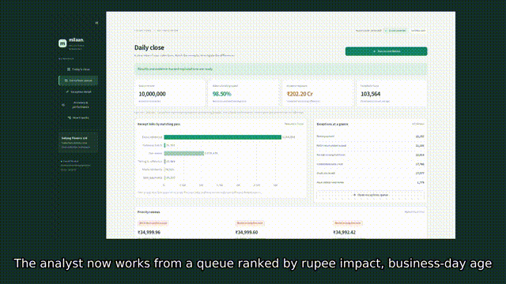
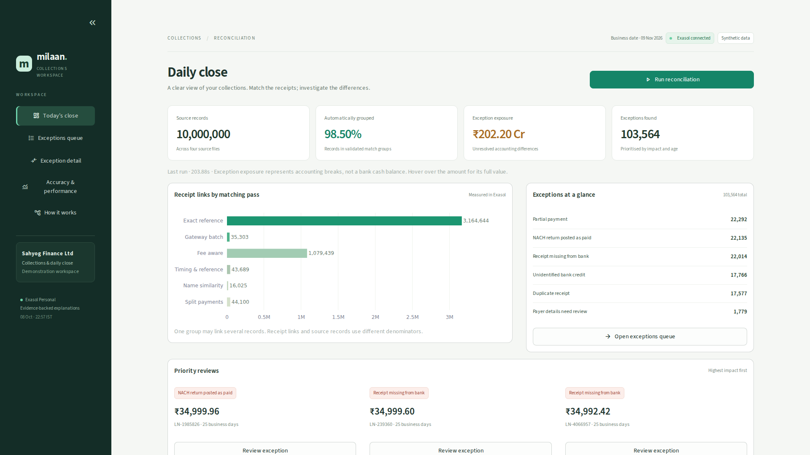
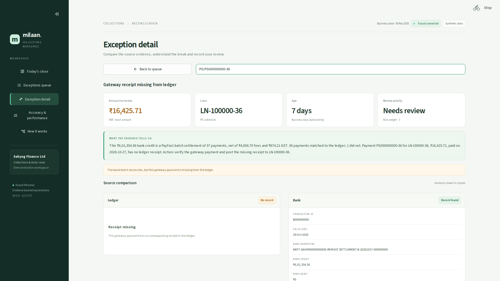
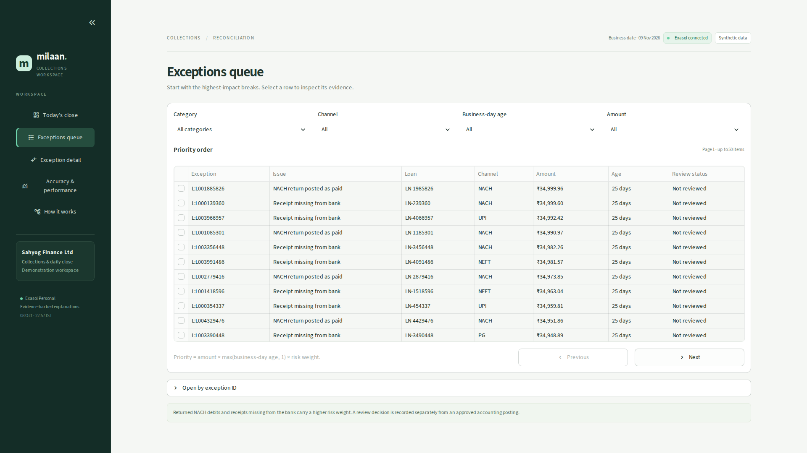
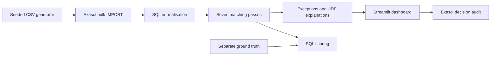

# Milaan: closing the books before noon

Evidence-backed payment reconciliation for Indian NBFCs, powered by Exasol Personal.

[](LICENSE)
[](https://github.com/Hemanth-Chilakala/milaan/actions/workflows/ci.yml)
[](https://codespaces.new/Hemanth-Chilakala/milaan)

The Singleton · Hemanth Chilakala · ExaThon India 2026 · Track 1: Money, Risk & Regulation.

## Problem statement

A reconciliation analyst at a mid-sized Indian NBFC can't close the day's books on time because UPI, NACH and payment-gateway settlement files arrive in different formats with mismatched references, so they chase breaks by hand in Excel. If this worked, they'd close the books before noon and spend their time only on the exceptions that actually matter.

References, settlement dates and gross versus net amounts disagree. Batch credits and returned auto-debits make a simple spreadsheet join insufficient. Suspense can delay closing and leave a paid customer looking overdue. These are illustrative workflow assumptions, not measured industry-wide statistics.

## Demonstration

[Download the narrated demo](docs/video/demo.mp4) · [Deck PDF](docs/deck/milaan_deck.pdf) · [PowerPoint](docs/deck/milaan_deck.pptx)







The video uses locally generated synthetic narration. The publisher can add an unlisted YouTube mirror after handoff; the local video is the submission artifact.

## What Milaan does

- Bulk-imports four synthetic collection files directly into Exasol.
- Runs seven explainable matching and classification passes inside the database.
- Handles fee netting, many-to-one settlements and bounded split payments.
- Ranks unresolved items by amount, business-day age and risk.
- Records analyst reviews and measures accuracy against separate ground truth.

## Why Exasol

Bulk IMPORT, SQL normalisation, joins, aggregation, window functions, similarity and subset-sum UDFs, explanations and scoring execute inside Exasol Personal. Python orchestrates SQL and displays aggregates or 50-row pages; it does not retrieve millions of transactions for matching.

<!-- MEASUREMENTS_START -->
10,000,000 source records reconciled in **203.88s** on **4 cores / 15.62 GiB RAM**. **98.502%** of source records were grouped; seeded link precision and recall were **100.000% / 99.959%**, with **0 false links**. The headline uses the live-recorded run when available. See [all measured benchmarks](docs/benchmarks.md) for separate import, pass and explanation timings.
<!-- MEASUREMENTS_END -->

The data is synthetic. Real operational accuracy requires independently labelled partner datasets; no production accuracy or close-time improvement is claimed.

## Architecture



See [architecture](docs/architecture.md) and [data model](docs/data_model.md).

## Quick start

Requirements: Python 3.12, Podman, and passwordless sudo for the verified container setup. Use at least 4 cores, 16 GB RAM and 32 GB disk; leave about 8 GB free for generated files and database growth. An 8-core/32-GB machine offers more headroom. Node.js, Playwright and ffmpeg are used for presentation exports.

### Option A: Codespaces

After publication, click the Codespaces badge. The devcontainer installs the launcher and Python dependencies. For an existing Codespace, open this folder as the workspace and run `bash .devcontainer/post-create.sh`; adding a devcontainer to a subfolder does not rebuild the parent workspace.

Accept the [Exasol Personal EULA](https://www.exasol.com/terms-and-conditions/#h-exasol-personal-end-user-license-agreement), then:

```bash
bash scripts/exasol-local.sh install local --auto-approve
bash scripts/exasol-local.sh slc install python3 --auto-approve
bash scripts/exasol-local.sh connect -f sql/00_feasibility.sql
sudo .venv/bin/python scripts/check_environment.py --write-env
make demo
```

Open forwarded port 8501. For the larger demonstration:

```bash
make data ROWS=10000000
make load DATA=data/10000000
make recon explain score
make app
```

`ROWS` is the combined source-record count across four files, not the number of ledger receipts. Ground truth and the calendar are additional files. Generation reuses an existing seed-42 dataset with the requested size; it never overwrites source CSVs.

The wrapper uses rootful Podman, crun and native workspace storage because Python runtime mounts failed under this host's nested rootless setup. Use it consistently:

```bash
bash scripts/exasol-local.sh info
bash scripts/exasol-local.sh stop
bash scripts/exasol-local.sh start
```

If the container stops answering after an idle period, stop and start it with the wrapper. Keep port 8563 private. See [environment verification](docs/environment.md).

### Option B: local Linux, macOS or Windows

Ubuntu Linux: clone and enter the published repository, run `bash .devcontainer/post-create.sh`, then follow the deployment and `make demo` commands above. Podman storage must use a native filesystem. Windows: use Ubuntu under WSL2, make at least 16 GB RAM available, install Python 3.12 and Podman, and follow those Linux commands.

macOS: install Python 3.12 and use the [official Exasol Personal local deployment](https://exasol.github.io/exasol-personal/latest/) with its supported Podman-machine setup. The Codespace-specific sudo wrapper is not a macOS launcher. Connect the app to that deployment:

```bash
python3.12 -m venv .venv
.venv/bin/python -m pip install -r requirements.lock
cp .env.example .env
# Set host, TLS fingerprint and credentials from your deployment in .env.
make demo
```

The nested Linux Codespace path has been exercised. macOS and Windows host deployments have not been independently tested.

## Configuration

| Variable | Purpose |
|---|---|
| `EXASOL_DSN` | `host/SHA256-fingerprint:8563`; encrypted, certificate pinned |
| `EXASOL_USER` | Deployment login |
| `EXASOL_PASSWORD` | Private deployment secret; `.env` is ignored |

The local environment check writes `.env` with owner-only permissions and preserves existing files. No inference API key is required. Explanations are evidence templates executed inside Exasol. `LLM_PROVIDER` and `LLM_API_KEY` are commented future-extension placeholders; this release makes no external inference calls. The tested PII masking helper is available for future integration.

## Usage

| Target | Purpose |
|---|---|
| `make setup` | Connect; create schemas and Python UDFs |
| `make data ROWS=1000000` | Generate or reuse seed-42 data; default 1M |
| `make load DATA=data/1000000` | Bulk import and SQL normalisation |
| `make recon` | Seven passes, timings, conflict validation and SQL scoring |
| `make explain` | Generate exception explanations inside Exasol |
| `make score` | Print overall and per-break scores |
| `make app` | Start dashboard on port 8501 |
| `make bench` | Measure 1M and 10M runs; update benchmark artifacts |
| `make demo` | Setup, data, load, reconcile, explain and app |
| `make test` | Run tests without a database |
| `make lint` | Ruff lint and formatting checks |

For custom scenario rates, edit `generator/config.yaml` and choose a fresh output folder. Direct generator options are available with `.venv/bin/python -m generator.generate --help`.

Review decisions record acceptance of a recommendation, rejection or assignment. They do not change a real ledger or turn an unverified exception into an automatic match.

## Data

**All data is synthetic, generated by `generator/`. No real customer, bank or employer data is used.**

Sahyog Finance Ltd, Bharat Union Bank, PayFast and the handles are fictional in this demonstration. Faker generates customer-name strings; any resemblance to people is coincidental. Dates, holidays and scenario rates are illustrative. Integer paise comparisons avoid floating-point money errors.

Ground truth records correct links and break labels. Matching never reads it. Precision and recall measure links; auto-match rate measures source membership in groups. A gateway payment can belong to a valid bank batch while still raising a missing-ledger exception.

## Accuracy, benchmarks and tests

[Benchmark report](docs/benchmarks.md) · [Machine-readable observations](docs/benchmark_results.json) · [Reproduction review](docs/reproducibility.md) · [Interface review](docs/ui_review.md)

Reports include run IDs, pass timings and native Exasol profiling. No pandas comparison is claimed.

```bash
make lint test
.venv/bin/python -m pytest -m db
```

Database tests replace active demo tables with a small synthetic fixture. Reload your demo dataset afterward. Tests cover known links, every break type, conflict rejection, batch evidence, auditing and repeatability. CI runs lint and the non-database tests; hosted CI status becomes available after publication.

## Limitations and roadmap

The generator uses distinct loan IDs and constrained corruption patterns. Perfect seeded scores should not be extrapolated to production feeds. Ambiguous candidates stay unresolved; subset matching examines at most 12 credits and only subsets of two or three. The calendar is fictional. This is a single-node Personal deployment with one reconciliation worker, no role-based access control and no real accounting connector.

Next: independently labelled partner validation, configurable feed adapters, SFTP/API ingestion, a real holiday calendar, distributed worker coordination, authenticated review roles and approved ledger write-back. Larger-scale and cluster performance must be measured before claims are made.

## Licence and team

MIT, copyright 2026 Hemanth Chilakala. See [LICENSE](LICENSE) and [CONTRIBUTING](CONTRIBUTING.md).

**The Singleton** · **Hemanth Chilakala** ([Hemanth-Chilakala](https://github.com/Hemanth-Chilakala)).

Repository destination: https://github.com/Hemanth-Chilakala/milaan. Development and commit history remain local for handoff; publishing and submission happen separately.
