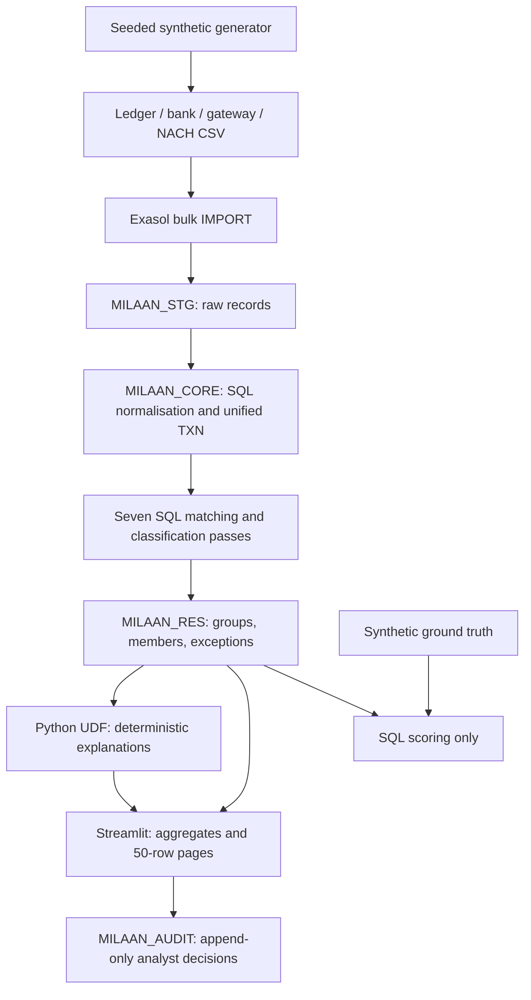

# Architecture

Amounts remain integer paise throughout comparisons. The business calendar includes fictional holidays and gives each date a business-day index. Source-specific normalised tables retain settlement fields; the unified `TXN` table provides a consistent cross-source inventory.

Matching uses unique candidate joins and only considers unconsumed source keys. Batch and split relationships have one group ID with multiple edges. A final validation rejects source membership in more than one group. Split proposals are capped at 12 candidate credits and subsets of two or three, with ambiguous solutions declined.

Normalisation prepares narrow `OPEN_LEDGER`, `OPEN_BANK` and `OPEN_PG` tables. Each pass removes consumed keys using its own small edge table. Reruns restore the open sets from the immutable normalised sources; this preparation is timed. Reference suffixes and conformed join keys are stored as columns. Split groups are filtered in SQL before the native Lua SET UDF runs, and an independent Python implementation checks its output in the database tests.

The orchestrator holds a nonblocking local file lock while reconciling. This supports one dashboard process and command-line runner in the same checkout. Multiple distributed workers would need database-backed coordination before production use. Load operations should run while the dashboard is idle.

Every pass commits its measured results and audit timing. Failure marks a run failed; the dashboard must not interpret partial results as a completed close. Re-running rebuilds current results and preserves decision history with its original run IDs. Decisions record review actions; the demonstration does not write to a real loan-management system.

Explanations run inside Exasol as Python scalar UDFs over structured exception evidence. No external inference service is called. The PII masking helper is tested for a future optional rewrite, but an external LLM integration is not shipped.

Bulk imports use `pyexasol.import_from_file`. TLS connections pin the local certificate fingerprint. A small compatibility subclass handles Nano's release suffix during pyexasol's import capability check.

Session-level profiling follows the [official Exasol documentation](https://docs.exasol.com/db/latest/database_concepts/profiling.htm); detailed scan, join, CPU and memory statistics accompany wall-clock timings. Result materialisation, SQL scoring and validation are also timed and profiled. Profiling collection is excluded from the reconciliation timer and measured separately, as is explanation generation. [performance.md](performance.md) contains the before/after comparison and exact result checks.
